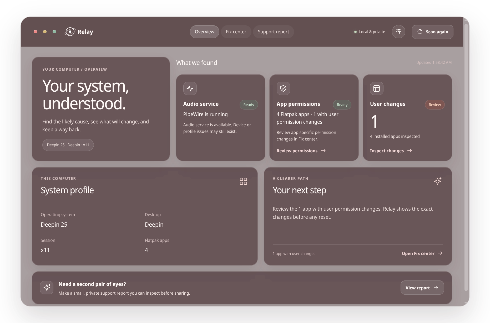

# Orbit Relay

Your Linux setup, repairable and portable. Relay is a local desktop companion for understanding common problems and applying narrowly scoped, reviewable repairs.

The interface shares Orbit's warm translucent dashboard appearance. The frameless window shows your actual desktop through its clear corners and glass panels. Use the top bar slider to set transparency from 0% to 80%; Relay remembers your choice locally. The app contains no wallpaper or theme picker.



## Open the app

Orbit Relay is installed for this user. Find **Orbit Relay** in the application menu under System and open it like any other desktop app. The installed executable is at `~/.local/opt/orbit-relay/0.1.1/orbit-relay`.

Ready-to-install Linux packages are in `release/`:

- `Orbit-Relay-0.1.1-linux-amd64.deb` for Debian and Ubuntu family systems.
- `Orbit-Relay-0.1.1-linux-x86_64.AppImage` for other x86-64 systems that support AppImage.

The local app-menu installation uses the packaged `linux-unpacked` build, avoiding a system-wide install and AppImage runtime requirements. The Debian package is built but not installed on this computer. These packages are not signed or published yet.

## First release

- Detects distribution, desktop, session, Flatpak and user audio service status.
- Shows the count of Flatpak apps with user permission changes in the overview.
- Shows installed Flatpak applications with user permission overrides.
- Previews the exact per-app override file before resetting that app's **user** overrides. Makes a private backup and offers undo. System-wide overrides and application data are untouched.
- Exports a previewable support report. It omits usernames, hostnames, paths, network addresses, app names, logs, and command output.

Relay currently supports Linux desktop sessions. Flatpak repair needs the `flatpak` command and applies only to user overrides. Audio checks need a systemd user session. Unsupported checks stay unknown.
Restart the affected Flatpak app after a reset. Undo copies are kept in Relay's private application data directory so undo remains available after reopening the app.

The [build path](docs/ROADMAP.md) describes the next repair packs, setup blueprint, and activity profiles.

## Build from source

Requires Node.js 22.12+ and a Linux graphical desktop.

```bash
npm ci
npm run build:linux
npm run install:user
```

`npm start` runs the source checkout for development. The install command creates a versioned copy under `~/.local/opt/orbit-relay/` and an application-menu entry under `~/.local/share/applications/`.
To refresh an existing installed version after rebuilding, run `npm run install:user:replace`; the installer stages the new files and restores the previous copy if installation fails.

For checks without a graphical session:

```bash
npm run check
npm test
npm run test:desktop
```

The renderer is sandboxed. It receives only validated results through fixed IPC handlers. The app makes no network requests. More repair recipes and a portable setup blueprint are planned after this first workflow is validated with users.
